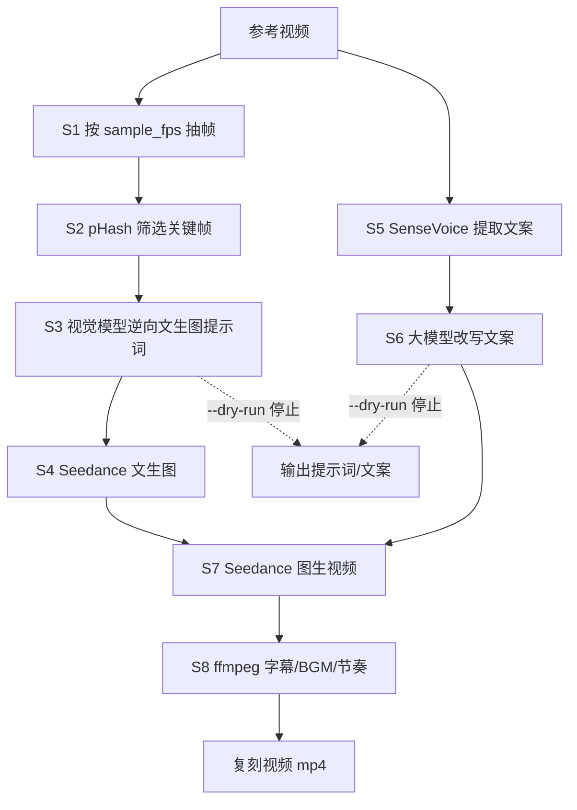

# copy 子命令：视频复刻（逆向文生图提示词 → Seedance 复刻生成）

如果你见过一段爆款短视频，想用同样的画面风格、镜头语言和文案节奏重新生成一版，BookerAutoVideo 项目里的 `copy` 子命令就是为这个场景设计的——它从参考视频出发，抽帧、提取关键帧、用视觉大模型逆向还原文生图提示词、Seedance 文生图；同时用 SenseVoice 提取口播文案、大模型改写文案；最后 Seedance 图生视频、ffmpeg 加字幕/BGM/节奏，产出复刻视频。

整个流程是**八阶段流水线**，分**画面路线**和**文案路线**两条支路，最后合流：

```
输入参考视频
├─ 画面路线：S1 抽帧 → S2 pHash 关键帧 → S3 逆向文生图提示词 → S4 Seedance 文生图
├─ 文案路线：S5 SenseVoice 提取文案 → S6 大模型改写文案
└─ S7 Seedance 图生视频（图片 + 改写文案）→ S8 ffmpeg 字幕/BGM/节奏 → 发布/变现
```

用 mermaid 表示：



---

## 一、子命令入口和参数

`copy` 的参数定义在 `copy_video.py` 的 `reg_subparser` 里：

```python
def reg_subparser(subparsers):
    parser = subparsers.add_parser(
        'copy',
        help='视频复刻：抽帧 → 关键帧 → 逆向文生图提示词 → Seedance 文生图/图生视频 → ffmpeg 后期',
    )
    parser.add_argument('VIDEO', help='参考视频路径')
    parser.add_argument('-o', '--out', default='output/copy', help='输出目录')
    parser.add_argument('--sample-fps', type=float, default=1.0, help='初筛抽帧频率')
    parser.add_argument('--phash-threshold', type=int, default=10, help='pHash 汉明距离阈值')
    parser.add_argument('--max-keyframes', type=int, default=10, help='送视觉模型的关键帧上限')
    parser.add_argument('--hash-size', type=int, default=8, help='pHash 尺寸')
    parser.add_argument('--vision-detail', choices=['low', 'high'], default='low', help='OpenAI 图片 detail')
    parser.add_argument('--image-model', default='seedance-image', help='Seedance 文生图模型名')
    parser.add_argument('--image-ratio', default='16:9', help='文生图画幅')
    parser.add_argument('--image-resolution', default='1080p', help='文生图分辨率')
    parser.add_argument('--gen-duration', type=int, default=8, choices=[4, 8, 12], help='图生视频时长')
    parser.add_argument('--gen-resolution', default='1080p', help='图生视频分辨率')
    parser.add_argument('--gen-ratio', default='16:9', help='图生视频画幅')
    parser.add_argument('--gen-audio', action='store_true', default=True, help='是否生成音频')
    parser.add_argument('--no-gen-audio', action='store_false', dest='gen_audio', help='关闭音频生成')
    parser.add_argument('--sensevoice-key', default=None, help='SenseVoice API Key')
    parser.add_argument('--sensevoice-host', default=None, help='SenseVoice Base URL')
    parser.add_argument('--sensevoice-model', default='sensevoice-small', help='SenseVoice 模型名/本地目录')
    parser.add_argument('--asr-language', default='zh', help='ASR 语言')
    parser.add_argument('--rewrite-requirement', default=None, help='文案改写要求（文件路径或文本）')
    parser.add_argument('--no-rewrite', action='store_true', help='跳过 S6，直接使用原始文案')
    parser.add_argument('--seedance-key', default=None, help='Seedance API Key')
    parser.add_argument('--seedance-host', default=None, help='Seedance Base URL')
    parser.add_argument('--seedance-model', default='seedance-2.0', help='图生视频模型名')
    parser.add_argument('--poll-timeout', type=int, default=600, help='轮询超时秒')
    parser.add_argument('--subtitle', default=None, help='字幕文件路径（.srt/.ass）')
    parser.add_argument('--bgm', default=None, help='BGM 文件路径')
    parser.add_argument('--bgm-volume', type=float, default=0.25, help='BGM 音量')
    parser.add_argument('--rhythm', default=None, help='节奏配置 JSON')
    parser.add_argument('--no-post', action='store_true', help='跳过 S8 ffmpeg 后期')
    parser.add_argument('--dry-run', action='store_true', help='只到 S3 与 S6')
    parser.add_argument('--force', action='store_true', help='忽略缓存强制重跑')
    parser.set_defaults(func=copy)
```

参数表：

| 参数 | 类型 | 默认 | 说明 |
|------|------|------|------|
| `VIDEO` | 位置参数 | 必填 | 参考视频路径 |
| `-o/--out` | str | `output/copy` | 输出目录 |
| `--sample-fps` | float | `1.0` | 初筛抽帧频率（帧/秒） |
| `--phash-threshold` | int | `10` | pHash 汉明距离阈值，越大越容易筛出关键帧 |
| `--max-keyframes` | int | `10` | 送视觉模型的关键帧上限，超出则均匀采样截断 |
| `--hash-size` | int | `8` | pHash 尺寸 |
| `--vision-detail` | choice | `low` | OpenAI 图片 detail：`low`/`high` |
| `--image-model` | str | `seedance-image` | Seedance 文生图模型名 |
| `--image-ratio` | str | `16:9` | 文生图画幅 |
| `--image-resolution` | str | `1080p` | 文生图分辨率 |
| `--gen-duration` | int | `8` | 图生视频时长（4/8/12 秒） |
| `--gen-resolution` | str | `1080p` | 图生视频分辨率 |
| `--gen-ratio` | str | `16:9` | 图生视频画幅 |
| `--gen-audio` / `--no-gen-audio` | flag | 开 | 是否生成音频 |
| `--sensevoice-key` | str | 环境变量 | SenseVoice API Key |
| `--sensevoice-host` | str | 环境变量 | SenseVoice Base URL |
| `--sensevoice-model` | str | `sensevoice-small` | SenseVoice 模型名（API）/ 本地模型目录 |
| `--asr-language` | str | `zh` | ASR 语言 |
| `--rewrite-requirement` | str | 内置模板 | 文案改写要求（文件路径或直接文本） |
| `--no-rewrite` | flag | 关 | 跳过 S6，直接使用原始文案 |
| `--seedance-key` | str | 环境变量 | Seedance API Key |
| `--seedance-host` | str | 环境变量 | Seedance Base URL |
| `--seedance-model` | str | `seedance-2.0` | 图生视频模型名 |
| `--poll-timeout` | int | `600` | 轮询超时秒 |
| `--subtitle` | str | 空 | 字幕文件路径（`.srt`/`.ass`） |
| `--bgm` | str | 空 | BGM 文件路径 |
| `--bgm-volume` | float | `0.25` | BGM 音量 |
| `--rhythm` | str | 空 | 节奏配置 JSON（截取/变速/拼接） |
| `--no-post` | flag | 关 | 跳过 S8 ffmpeg 后期 |
| `--dry-run` | flag | 关 | 只执行 S1–S3 与 S5–S6 |
| `--force` | flag | 关 | 忽略缓存强制重跑 |
| `--keep-frames` | flag | 关 | 保留全部采样帧（日志详情） |
| `--no-polish` | flag | 关 | 关闭 S3 提示词润色 |

公共参数（继承自入口）：

- `-vm/--vmodel`：**视觉模型**（S3 必用）。若未传，回退到 `-m/--model`；二者皆空则报错退出（退出码 2）。
- `-m/--model`：文本模型，用于 S6 文案改写、S3 提示词润色（可选，`--no-polish` 可关）。
- `-k/--key`、`-H/--host`：OpenAI 鉴权与网关，S3/S6 直接复用。
- 重试/温度/超时：沿用入口公共参数（`-r/--retry`、`-tm/--temp`、`-rt/--read-timeout` 等）。

---

## 二、环境变量（`.env` / 系统环境）

CLI 参数优先级：**CLI > 环境变量 > 默认值**。

```ini
# Seedance API（文生图 + 图生视频）
SEEDANCE_API_KEY=
SEEDANCE_BASE_URL=https://ark.cn-beijing.volces.com/api/v3
SEEDANCE_MODEL=seedance-2.0
SEEDANCE_IMAGE_MODEL=seedance-image

# SenseVoice ASR
SENSEVOICE_API_KEY=
SENSEVOICE_BASE_URL=
SENSEVOICE_MODEL=sensevoice-small

# OpenAI（S3 视觉模型 / S6 文本模型）
OPENAI_API_KEY=
OPENAI_BASE_URL=
OPENAI_CHAT_MODEL=
OPENAI_VIS_MODEL=
```

> **注意**：Seedance 官方 SDK 要求 API Key 以 `sk-video-` 开头。如果你的 Key 不是该格式，SDK 会抛 `ConfigurationError`，请检查 Key 是否正确。

---

## 三、使用示例

### 示例 1：完整复刻（S1–S8 全流程）

```bash
python -m BookerAutoVideo copy 参考视频.mp4 \
  -vm your-vision-model \
  -m your-text-model \
  --gen-duration 8 \
  --gen-resolution 1080p \
  --gen-ratio 16:9
```

运行后，在 `output/copy/` 下生成 `copy_<hash>_<ts>.mp4` 复刻视频，同时在 `data/copy/<hash>/` 下保存全部中间产物。

### 示例 2：dry-run 只逆向 + 改写（不调用 Seedance）

```bash
# 只执行 S1–S3 与 S5–S6，输出文生图提示词和改写文案后停止，不产生 Seedance 费用
python -m BookerAutoVideo copy 参考视频.mp4 \
  -vm your-vision-model \
  -m your-text-model \
  --dry-run
```

运行后，在 `output/copy/` 下生成 `*.image_prompt.txt`（文生图提示词）、`*.transcript.txt`（原始文案）、`*.rewritten.txt`（改写文案）。适合先查看逆向还原与改写效果，再决定是否调用 Seedance 生成。

### 示例 3：断点续跑（删除 mp4 后重跑，复用已完成任务）

```bash
# 第一次运行生成复刻视频
python -m BookerAutoVideo copy 参考视频.mp4 -vm your-vision-model -m your-text-model

# 手动删除输出的 mp4
rm output/copy/copy_<hash>_<ts>.mp4

# 第二次运行：S1–S7 命中缓存跳过，S8 重新下载/后期（S4/S7 任务已完成则复用，不重复创建）
python -m BookerAutoVideo copy 参考视频.mp4 -vm your-vision-model -m your-text-model
```

若 S4 文生图、S7 图生视频任务已完成，续跑时会先查任务状态，直接复用结果，不重复创建任务（避免重复扣费）。

### 示例 4：仅后期（给已生成视频加字幕/BGM/节奏）

```bash
# 通过 --no-post 之外的参数组合，对 S7 生成的视频做后期
python -m BookerAutoVideo copy 参考视频.mp4 \
  -vm your-vision-model -m your-text-model \
  --subtitle 字幕.srt \
  --bgm 背景音乐.mp3 --bgm-volume 0.3 \
  --rhythm '{"trim": [0, 8], "speed": 1.0}'
```

---

## 四、缓存说明

所有阶段产物落盘到 `data/copy/<video_hash>/`，其中 `video_hash` 是参考视频文件内容 sha256 的前 16 位，作为缓存键。

```
data/copy/<hash>/
├── state.yaml                 # 全流程状态（断点续跑核心，stage 字段记录已完成阶段）
├── frames/                    # S1 样本帧（frame_000000.jpg …）
├── keyframes/                 # S2 关键帧（kf_000_t0.00s.jpg …）
├── reversed_image_prompt.txt  # S3 逆向文生图提示词
├── images/                    # S4 文生图（seedance_image_0.jpg）
├── transcript.txt             # S5 SenseVoice 原始文案
├── rewritten_script.txt       # S6 改写文案
├── image_task.json            # S4 文生图任务记录
└── video_task.json            # S7 图生视频任务记录
```

**断点续跑**：任一阶段产物已存在且校验通过，则跳过该阶段；`--force` 强制重跑。

- `state.yaml` 的 `stage` 字段取值：`init` / `done_s1` … `done_s8`。
- 画面路线（S1–S4）与文案路线（S5–S6）状态独立记录，便于后续并行化。
- S4/S7 续跑时，若已有任务 ID，先查任务状态；若任务已完成，直接复用结果，不重复创建任务。

---

## 五、常见错误与排查

| 场景 | 行为 | 退出码 | 排查建议 |
|------|------|--------|----------|
| 视频不存在 / 无法打开 | 明确报错 | 2 | 检查 `VIDEO` 路径是否正确，文件是否可读 |
| 未配置视觉模型（`-vm` 与 `-m` 均空） | 报错并提示参数 | 2 | 传入 `-vm your-vision-model`，或设置 `OPENAI_VIS_MODEL` |
| 无关键帧（样本帧为空） | 报错 + 调参建议 | 2 | 调低 `--phash-threshold`，或提高 `--sample-fps` |
| 视觉模型不支持图片输入 | 报错 + 换模型建议 | 3 | 更换支持多模态输入的模型（`-vm` 传入视觉模型） |
| Seedance 鉴权失败（401/403） | 报错 + 检查 key/host | 4 | 检查 `--seedance-key`/`SEEDANCE_API_KEY` 是否正确，是否以 `sk-video-` 开头 |
| 轮询超时 | 报错 + 保留 task_id 供续跑 | 5 | 增大 `--poll-timeout`，或手动续跑（复用已有 task_id） |
| 下载失败（重试后） | 报错 + 保留 URL | 6 | 检查网络，`video_url` 是否仍有效 |
| SenseVoice 无音频 / ASR 失败 | 报错 + 检查音频流或 ASR 配置 | 7 | 确认视频含音频流；配置 `--sensevoice-key/host` 或本地模型目录 |
| ffmpeg 后期失败 | 报错 + 保留中间视频路径 | 8 | 检查字幕/BGM 文件是否存在、格式是否被 ffmpeg 支持 |

**日志**：控制台会打印各阶段耗时与关键统计（源帧率、采样帧数、关键帧数、视觉模型名、文生图任务 ID、ASR 模型、文本模型、图生视频任务 ID、视频 URL、后期参数）。如需调试，加上 `-D/--debug` 开启 DEBUG 级别日志。

**密钥安全**：日志中不打印 API Key；`state.yaml` 不落密钥。

---

## 六、输出物

```
output/copy/
├── copy_<hash>_<ts>.mp4              # 最终复刻视频（含后期）
├── copy_<hash>_<ts>.image_prompt.txt # 逆向文生图提示词（dry-run 也产出）
├── copy_<hash>_<ts>.transcript.txt   # SenseVoice 原始文案（dry-run 也产出）
└── copy_<hash>_<ts>.rewritten.txt    # 大模型改写文案（dry-run 也产出）
```

---

## 七、模块与分层

`copy` 采用与 `remotion` / `comic-drama` 一致的分层：

| 文件 | 职责 |
|------|------|
| `copy_video.py` | 主模块：`reg_subparser` + `CopyOrchestrator` 八阶段编排 + `copy(args)` 入口 |
| `copy_models.py` | Pydantic 数据模型（VideoMeta / Keyframe / ImagePromptResult / ImageResult / Transcript / RewriteResult / SeedanceImageTask / SeedanceVideoTask / PostConfig / CopyState） |
| `copy_pmt.py` | 提示词模板（逆向文生图、润色、改写）+ 图片 base64 编码纯函数 |
| `seedance.py` | Seedance 客户端（基于 seedance-sdk）：文生图 / 图生视频 / 轮询 / 下载 |
| `sensevoice.py` | SenseVoice 客户端：API 模式 + 本地 FunASR 回退，统一 `transcribe()` 接口 |
| `ffmpeg_post.py` | ffmpeg 后期：字幕烧录 / BGM 混音 / 节奏处理 |

---

## 八、验收检查

- [x] `BookerAutoVideo copy --help` 正常输出，参数齐全，默认值正确。
- [x] 三个入口（`BookerAutoVideo`/`bav`/`auto-video`）均可执行 `copy`。
- [x] 对一段 ≥ 10s 的真实视频，`--dry-run` 能产出关键帧目录、`reversed_image_prompt.txt`、`transcript.txt`、`rewritten_script.txt`。
- [x] 完整运行能产出 Seedance 图片、图生视频 mp4；配置 `--subtitle`/`--bgm` 后能产出带字幕/BGM 的 mp4。
- [x] 第二次运行命中缓存，已完成阶段跳过，日志显示“cache hit”。
- [x] `--force` 能强制重跑。
- [x] 断点续跑：删除 mp4 后重跑，复用 S4 图片与 S7 任务，不重复创建已完成任务。
- [x] 视觉模型填成纯文本模型时，给出清晰错误（退出码 3）。
- [x] SenseVoice 未配置或音频缺失时，给出清晰错误（退出码 7）。
- [x] `--no-rewrite` 直接使用原始文案；`--no-post` 跳过 ffmpeg 后期。
- [x] 现有十个子命令全部回归通过，`--help` 无变化。
- [x] `doc/copy.md` 完成，含参数表、工作流图与示例。
- [x] 依赖已写入 `pyproject.toml`（`imagehash`、`Pillow`、`seedance-sdk`）。