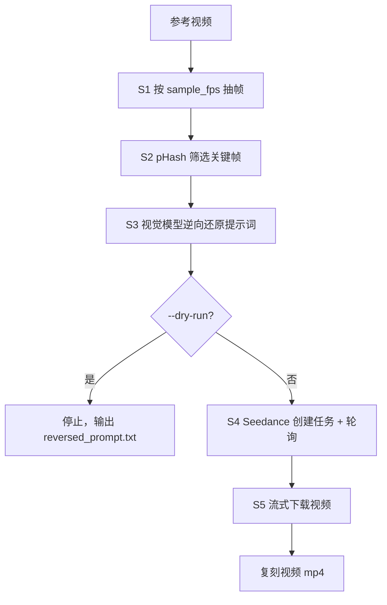

# copy 子命令：视频复刻（逆向还原提示词 → Seedance 复刻生成）

如果你见过一段爆款短视频，想用同样的镜头语言、节奏和氛围重新生成一版，BookerAutoVideo 项目里的 `copy` 子命令就是为这个场景设计的——它从参考视频出发，抽帧、提取关键帧、用视觉大模型逆向还原 Seedance 提示词，再调用 Seedance API 生成复刻视频并下载到本地。

整个流程可以拆成五个阶段：

1. **抽帧**：按指定频率从参考视频中截取采样帧；
2. **关键帧提取**：用 pHash 感知哈希比对相邻帧，筛选出画面变化显著的关键帧；
3. **逆向提示词**：把关键帧按时间顺序喂给视觉大模型，逆向还原一段可直接用于 Seedance 的提示词；
4. **Seedance 生成**：调用 Seedance API 提交生成任务，轮询直到完成，取回视频 URL；
5. **下载**：把生成的视频流式下载到本地输出目录。

下面用 mermaid 把这个流程画出来：



---

## 一、子命令入口和参数

`copy` 的参数定义在 `copy_video.py` 的 `reg_subparser` 里：

```python
def reg_subparser(subparsers):
    parser = subparsers.add_parser(
        'copy',
        help='视频复刻：抽帧 → 关键帧 → 逆向 Seedance 提示词 → 生成 → 下载',
    )
    parser.add_argument('VIDEO', help='参考视频路径')
    parser.add_argument('-o', '--out', default='output/copy', help='输出目录')
    parser.add_argument('--sample-fps', type=float, default=1.0, help='初筛抽帧频率')
    parser.add_argument('--phash-threshold', type=int, default=10, help='pHash 汉明距离阈值')
    parser.add_argument('--max-keyframes', type=int, default=10, help='送视觉模型的关键帧上限')
    parser.add_argument('--hash-size', type=int, default=8, help='pHash 尺寸')
    parser.add_argument('--vision-detail', choices=['low', 'high'], default='low', help='OpenAI 图片 detail')
    parser.add_argument('--gen-duration', type=int, default=8, choices=[4, 8, 12], help='生成时长')
    parser.add_argument('--gen-resolution', default='1080p', choices=['480p', '720p', '1080p'], help='生成分辨率')
    parser.add_argument('--gen-ratio', default='16:9', choices=['16:9', '9:16', '1:1', '4:3', '3:4'], help='画幅比例')
    parser.add_argument('--gen-audio', action='store_true', default=True, help='是否生成音频')
    parser.add_argument('--no-gen-audio', action='store_false', dest='gen_audio', help='关闭音频生成')
    parser.add_argument('--seedance-key', default=None, help='Seedance API Key')
    parser.add_argument('--seedance-host', default=None, help='Seedance Base URL')
    parser.add_argument('--seedance-model', default='seedance-2.0', help='生成模型名')
    parser.add_argument('--poll-timeout', type=int, default=600, help='轮询超时秒')
    parser.add_argument('--dry-run', action='store_true', help='只到 S3，不调用 Seedance')
    parser.add_argument('--force', action='store_true', help='忽略缓存强制重跑')
    parser.add_argument('--keep-frames', action='store_true', help='保留全部采样帧')
    parser.add_argument('--no-polish', action='store_true', help='关闭文本模型润色')
    parser.set_defaults(func=copy)
```

常用参数说明：

| 参数 | 类型 | 默认 | 说明 |
|------|------|------|------|
| `VIDEO` | 位置参数 | 必填 | 参考视频路径 |
| `-o/--out` | str | `output/copy` | 输出目录 |
| `--sample-fps` | float | `1.0` | 初筛抽帧频率（帧/秒） |
| `--phash-threshold` | int | `10` | pHash 汉明距离阈值，越大越容易筛出关键帧 |
| `--max-keyframes` | int | `10` | 送视觉模型的关键帧上限，超出则均匀采样截断 |
| `--hash-size` | int | `8` | pHash 尺寸 |
| `--vision-detail` | choice | `low` | OpenAI 图片 detail：`low`/`high` |
| `--gen-duration` | int | `8` | Seedance 生成时长（4/8/12 秒） |
| `--gen-resolution` | str | `1080p` | 生成分辨率（480p/720p/1080p） |
| `--gen-ratio` | str | `16:9` | 画幅比例（16:9/9:16/1:1/4:3/3:4） |
| `--gen-audio` / `--no-gen-audio` | flag | 开 | 是否生成音频 |
| `--seedance-key` | str | 环境变量 | Seedance API Key |
| `--seedance-host` | str | 环境变量 | Seedance Base URL |
| `--seedance-model` | str | `seedance-2.0` | 生成模型名 |
| `--poll-timeout` | int | `600` | 轮询超时秒 |
| `--dry-run` | flag | 关 | 只执行 S1–S3，输出逆向提示词后停止 |
| `--force` | flag | 关 | 忽略缓存强制重跑 |
| `--keep-frames` | flag | 关 | 保留全部采样帧（日志详情） |
| `--no-polish` | flag | 关 | 关闭文本模型润色（S3 步骤） |

公共参数（继承自入口）：

- `-vm/--vmodel`：**视觉模型**（S3 必用）。若未传，回退到 `-m/--model`；二者皆空则报错退出（退出码 2）。
- `-m/--model`：文本模型，用于 S3 提示词的最终润色（可选，`--no-polish` 可关）。
- `-k/--key`、`-H/--host`：OpenAI 鉴权与网关，S3 直接复用。
- 重试/温度/超时：沿用入口公共参数（`-r/--retry`、`-tm/--temp`、`-rt/--read-timeout` 等）。

---

## 二、环境变量（`.env` / 系统环境）

CLI 参数优先级：**CLI > 环境变量 > 默认值**。

```ini
# Seedance API
SEEDANCE_API_KEY=
SEEDANCE_BASE_URL=https://ark.cn-beijing.volces.com/api/v3
SEEDANCE_MODEL=seedance-2.0

# OpenAI（用于 S3 视觉模型 / 文本模型润色）
OPENAI_API_KEY=
OPENAI_BASE_URL=
OPENAI_CHAT_MODEL=
OPENAI_VIS_MODEL=
```

> **注意**：Seedance 官方 SDK 要求 API Key 以 `sk-video-` 开头。如果你的 Key 不是该格式，SDK 会抛 `ConfigurationError`，请检查 Key 是否正确。

---

## 三、使用示例

### 示例 1：完整复刻（S1–S5 全流程）

```bash
# 从参考视频逆向提示词，调用 Seedance 生成，下载复刻视频
python -m BookerAutoVideo copy 参考视频.mp4 \
  -vm your-vision-model \
  -m your-text-model \
  --gen-duration 8 \
  --gen-resolution 1080p \
  --gen-ratio 16:9
```

运行后，在 `output/copy/` 下生成 `copy_<hash>_<ts>.mp4` 复刻视频，同时在 `data/copy/<hash>/` 下保存中间产物（`state.yaml`、`keyframes/`、`reversed_prompt.txt`、`seedance_task.json`）。

### 示例 2：dry-run 只逆向提示词（不调用 Seedance）

```bash
# 只执行 S1–S3，输出逆向提示词后停止，不产生 Seedance 费用
python -m BookerAutoVideo copy 参考视频.mp4 \
  -vm your-vision-model \
  --dry-run \
  --no-polish
```

运行后，在 `output/copy/` 下生成 `copy_<hash>_<ts>.prompt.txt` 逆向提示词文件，并在控制台打印提示词内容。适合先查看逆向还原效果，再决定是否调用 Seedance 生成。

### 示例 3：断点续跑（删除 mp4 后重跑，复用 S4 任务）

```bash
# 第一次运行生成了复刻视频
python -m BookerAutoVideo copy 参考视频.mp4 -vm your-vision-model -m your-text-model

# 手动删除输出的 mp4
rm output/copy/copy_<hash>_<ts>.mp4

# 第二次运行：S1–S4 命中缓存跳过，S5 重新下载（若 S4 任务已完成则复用 video_url）
python -m BookerAutoVideo copy 参考视频.mp4 -vm your-vision-model -m your-text-model
```

若 S4 的 Seedance 任务已完成，续跑时会先查任务状态，直接复用 `video_url`，不重复创建任务（避免重复扣费）。

---

## 四、缓存说明

所有阶段产物落盘到 `data/copy/<video_hash>/`，其中 `video_hash` 是参考视频文件内容 sha256 的前 16 位，作为缓存键。

```
data/copy/<hash>/
├── state.yaml          # 全流程状态（断点续跑核心，stage 字段记录已完成阶段）
├── frames/             # S1 样本帧（frame_000000.jpg …）
├── keyframes/          # S2 关键帧（kf_000_t0.00s.jpg …）
├── reversed_prompt.txt # S3 逆向提示词
└── seedance_task.json  # S4 Seedance 任务记录
```

**断点续跑**：任一阶段产物已存在且校验通过，则跳过该阶段；`--force` 强制重跑。

- `state.yaml` 的 `stage` 字段取值：`init` / `done_s1` / `done_s2` / `done_s3` / `done_s4` / `done_s5`。
- 续跑时，`copy` 会从 `state.yaml` 恢复阶段，跳过已完成的阶段。
- S4 续跑时，若 `state.seedance_task_id` 已存在，先查任务状态；若任务已完成，直接复用 `video_url`，不重复创建任务。

---

## 五、常见错误与排查

| 场景 | 行为 | 退出码 | 排查建议 |
|------|------|--------|----------|
| 视频不存在 / 无法打开 | 明确报错 | 2 | 检查 `VIDEO` 路径是否正确，文件是否可读 |
| 未配置视觉模型（`-vm` 与 `-m` 均空） | 报错并提示参数 | 2 | 传入 `-vm your-vision-model`，或设置 `OPENAI_VIS_MODEL` 环境变量 |
| 无关键帧（如纯色视频） | 报错 + 调参建议 | 2 | 调低 `--phash-threshold`（如从 10 调到 5），或提高 `--sample-fps` |
| 视觉模型不支持图片输入 | 报错 + 换模型建议 | 3 | 更换支持多模态输入的模型（`-vm` 传入视觉模型，而非纯文本模型） |
| Seedance 鉴权失败（401/403） | 报错 + 检查 key/host | 4 | 检查 `--seedance-key` / `SEEDANCE_API_KEY` 是否正确，是否以 `sk-video-` 开头 |
| 轮询超时 | 报错 + 保留 task_id 供续跑 | 5 | 增大 `--poll-timeout`，或手动续跑（S4 会复用已有 task_id） |
| 下载失败（重试后） | 报错 + 保留 URL | 6 | 检查网络，`video_url` 是否仍有效 |

**日志**：控制台会打印各阶段耗时与关键统计（源帧率、采样帧数、关键帧数、模型名、任务 ID、视频 URL）。如需调试，加上 `-D/--debug` 开启 DEBUG 级别日志。

**密钥安全**：日志中不打印 API Key；`state.yaml` 不落密钥。

---

## 六、输出物

```
output/copy/
├── copy_<hash>_<ts>.mp4        # 最终复刻视频（完整运行产出）
└── copy_<hash>_<ts>.prompt.txt # 逆向提示词（dry-run 也产出）

data/copy/<hash>/
├── state.yaml
├── frames/
│   ├── frame_000000.jpg
│   └── ...
├── keyframes/
│   ├── kf_000_t0.00s.jpg
│   └── ...
├── reversed_prompt.txt
└── seedance_task.json
```

---

## 七、验收检查

- [ ] `BookerAutoVideo copy --help` 正常输出，参数齐全，默认值正确。
- [ ] 三个入口（`BookerAutoVideo`/`bav`/`auto-video`）均可执行 `copy`。
- [ ] 对一段 ≥ 10s 的真实视频，`--dry-run` 能产出关键帧目录 + `reversed_prompt.txt`，提示词语义合理。
- [ ] 完整运行能产出 mp4，文件可播放且大小 > 0。
- [ ] 第二次运行命中缓存，S1–S3 跳过，日志明确显示“cache hit”。
- [ ] `--force` 能强制重跑。
- [ ] 断点续跑：手动删除 mp4 后重跑，能复用 S4 的 task_id，不重复创建任务。
- [ ] 视觉模型填成纯文本模型时，给出清晰错误而非堆栈（退出码 3）。
- [ ] 现有十个子命令（`gen`/`note`/`ext-ppt`/`metric`/`clip-test`/`split`/`remotion`/`sv2api`/`comic-drama`/`md2note`）全部回归通过，`--help` 无变化。
- [ ] 依赖已写入 `pyproject.toml`（`imagehash`、`Pillow`、`seedance-sdk`）。
- [ ] 代码通过现有 lint/format 规则；无硬编码密钥；日志用项目统一 logger。