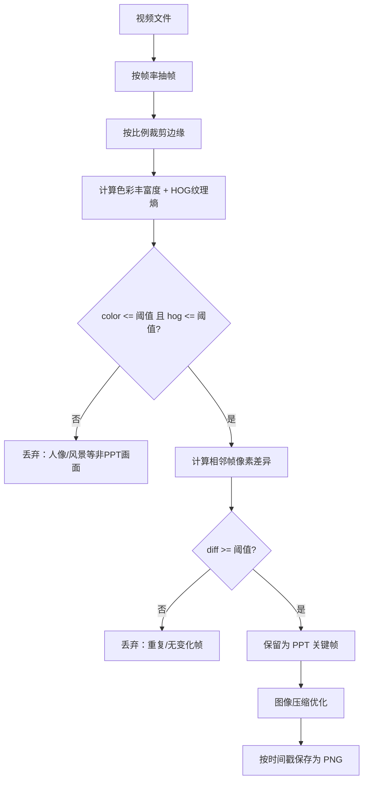
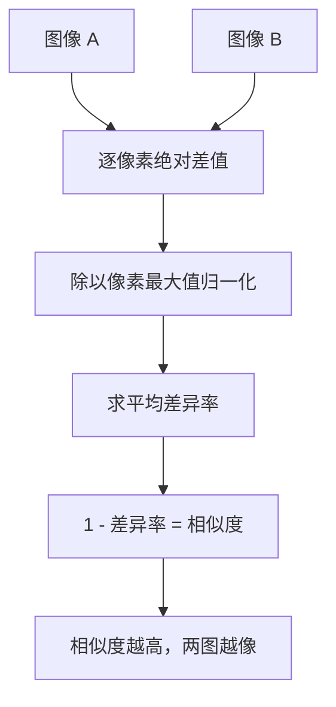
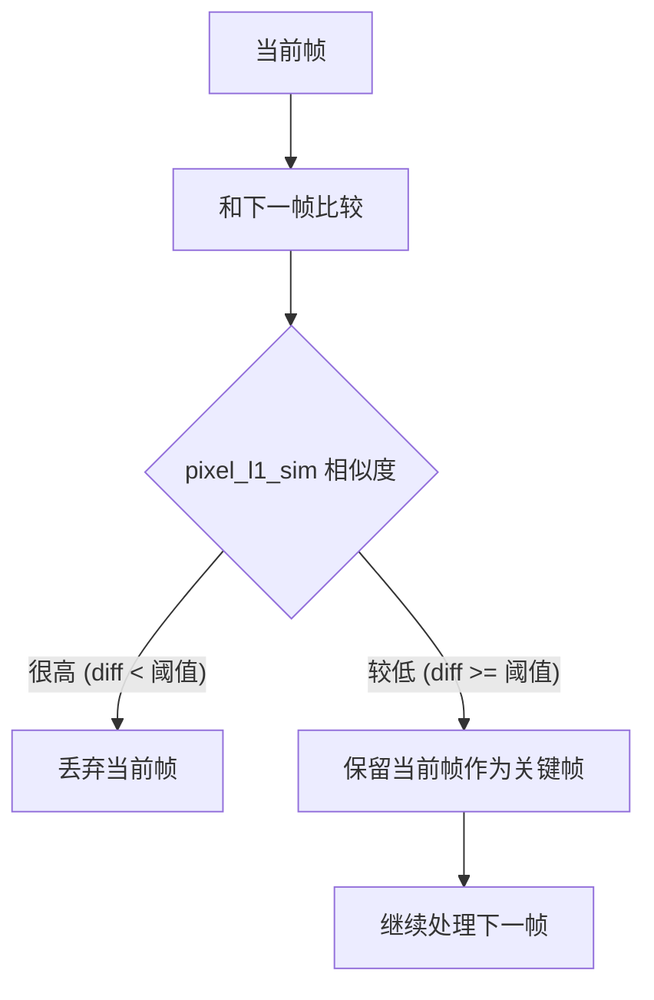

# ext-ppt 子命令：从视频中识别 PPT 关键帧

如果你看过网课视频、录屏教程或产品演示，肯定遇到过这种情况：视频里大部分时间都在放一张张 PPT 幻灯片，讲师只是在上面划重点、讲解内容。你想把这些 PPT 提取出来整理成文档，但一张张手动截图又太累了。

BookerAutoVideo 项目里的 `ext-ppt` 子命令就是为这个场景设计的——它从视频中自动识别出哪些画面是 PPT 幻灯片，并把它们提取成独立的图片文件。

这篇文章用大白话，带你走一遍 `ext-ppt` 的完整原理，并贴出关键代码，方便你自己阅读、修改或扩展。

---

## 一、整体思路：三层过滤，留下 PPT

`ext-ppt` 的核心思想很简单：**先从视频里抽帧，再经过几道“过滤网”，把不像 PPT 的画面挡掉，最后剩下的就是 PPT 关键帧。**

整个流程可以拆成这几步：

1. **抽帧**：按指定频率从视频中截取画面；
2. **裁剪**：把边缘不需要的部分（比如字幕条）切掉；
3. **预过滤（色彩 + 纹理）**：PPT 通常色彩单一、纹理简单，人像和风景画面会被过滤掉；
4. **帧间差过滤**：相邻两帧差不多就丢弃，只保留“幻灯片切换”的那一刻；
5. **图像优化**：对保留下来的关键帧做压缩；
6. **保存**：按时间戳命名存成 PNG 文件。

下面用 mermaid 把这个流程画出来：



---

## 二、逐步拆解代码

下面是 `ext_ppt.py` 的完整核心代码，我会边贴代码边用大白话解释每一部分在干什么。

### 1. 子命令入口和参数注册

先看怎么把 `ext-ppt` 注册成一个可运行的子命令：

```python
import cv2
import numpy as np
import argparse
import os
import re
import math
import uuid
import tempfile
import subprocess as subp
from os import path
from imgyaso import adathres, adathres_bts
from .util import *
from .imgsim import *
import easyocr
import PIL
from .clip import *
import torchvision as tv
from concurrent.futures import ThreadPoolExecutor

DIR_F = 'forward'
DIR_B = 'backward'
DIR_T = 'twoway'

ocr_reader = None
PIL.Image.ANTIALIAS = PIL.Image.LANCZOS
```

这些是全局变量和常量：
- `DIR_F / DIR_B / DIR_T`：计算帧间差的方向，分别是“正向”、“反向”、“双向”。
- `ocr_reader`：EasyOCR 阅读器的全局单例，用于提取图片中的文字（目前代码里被注释掉了，但保留了接口）。

子命令的参数定义在 `reg_subparser` 里：

```python
def reg_subparser(subparsers):
    parser = subparsers.add_parser("ext-ppt", help="extract keyframes")
    parser.add_argument("fname", help="file name")
    parser.add_argument("-o", "--opti-mode", default="quant", help="img opti mode, default 'none'")
    parser.add_argument("-r", "--rate", type=float, default=0.2, help="how many frames to extract in 1s")
    parser.add_argument("-d", "--direction", choices=[DIR_F, DIR_B, DIR_T], default=DIR_B, help="the direction used to calc frame diff")
    parser.add_argument("-dt", "--diff-thres", type=float, default=0.1, help="img diff thres")
    parser.add_argument("-t", "--threads", type=int, default=8, help="#threads")
    parser.add_argument("-c", "--color", type=float, default=0.4, help="color entro")
    parser.add_argument("-H", "--hog", type=float, default=0.5, help="hog entro")
    parser.add_argument("--left", type=float, default=0, help="left cut 0~1")
    parser.add_argument("--right", type=float, default=0, help="right cut 0~1")
    parser.add_argument("--bottom", type=float, default=0, help="bottom cut 0~1")
    parser.add_argument("--top", type=float, default=0, help="top cut 0~1")
    parser.set_defaults(func=extract_ppt_file)
```

常用参数说明：
- `fname`：输入视频文件路径；
- `rate`：每秒抽取的帧数，默认 `0.2`，也就是每 5 秒抽一帧，这样既不会太慢，又不会漏掉幻灯片切换；
- `direction`：帧间差的计算方向，默认 `backward`（向后看）；
- `diff-thres`：判定“两帧不同”的差异阈值，默认 `0.1`；
- `color` / `hog`：色彩和纹理的过滤阈值，用来挡掉人像、风景；
- `left/right/top/bottom`：按比例裁剪图像边缘，比如去掉底部的字幕区域。

### 2. 从视频读取帧

视频是一连串的图片，我们先要把它拆成一张张单独的图。这步在 `extract_ppt` 函数里完成：

```python
def extract_ppt(args):
    print(args)
    check_cut_args(args)
    fname = args.fname
    # 从视频中读取帧
    imgs, _ = get_video_imgs(fname, args.rate)
```

`get_video_imgs` 定义在 `util.py` 里，用 OpenCV 按时间戳逐帧读取：

```python
def get_video_imgs(video, fps=0):
    if isinstance(video, bytes):
        fname = path.join(tempfile.gettempdir(), uuid.uuid4().hex + '.mp4')
        open(fname, 'wb').write(video)
    else:
        fname = video

    info = ffmpeg_get_info(fname)
    fps = fps or info['fps']

    cap = cv2.VideoCapture(fname)
    if not cap.isOpened():
        raise Exception(f'无法打开文件 {fname}')
    tm = 0
    total = info['duration']
    imgs = []
    while tm < total:
        cap.set(cv2.CAP_PROP_POS_MSEC, tm * 1000)
        succ, img = cap.read()
        if not succ: break
        imgs.append(img)
        tm += 1 / fps

    cap.release()
    ...
    return imgs, fps
```

简单说：它用 `cv2.VideoCapture` 打开视频，每隔 `1/fps` 秒抓一帧，存进列表返回。如果 `rate=0.2`，一个 10 分钟的视频就会抽出约 120 张图。

### 3. 裁剪边缘（去掉字幕、黑边等）

读取到的每一帧可能包含不需要的部分，比如底部的字幕条、两侧的黑边。`ext-ppt` 支持按比例裁剪：

```python
def check_cut_args(args):
    assert (
        args.left >= 0 and
        args.right >= 0 and
        args.top >= 0 and
        args.bottom >= 0
    )
    assert (
        args.left + args.right <= 1 and
        args.bottom + args.top <= 1
    )

def cut_img(img, args):
    h, w, *_ = img.shape
    left = int(args.left * w)
    right = -int(args.right * w)
    if right == 0:
        right = None
    top = int(args.top * h)
    bottom = -int(args.bottom * h)
    if bottom == 0:
        bottom = None
    return img[top:bottom, left:right]
```

例如 `--left 0.1 --right 0.1` 就会把图像左右各切掉 10%，剩下中间 80% 的区域。这对去掉视频边缘的噪点很有用。

### 4. 预过滤：用“色彩丰富度”和“纹理复杂度”挡掉非 PPT 画面

这是最关键的一步。PPT 幻灯片通常有以下特点：
- **色彩少**：大量白色背景、黑色文字，颜色单一；
- **纹理简单**：主要是直线、方块、文字，没有人脸的皮肤纹理，也没有风景的树叶、水纹。

相比之下，视频里的**人像**和**风景**画面色彩丰富、纹理复杂。所以我们可以用这两个指标把它们过滤掉。

先计算每帧的两个指标：

```python
def tr_calc_met(f):
    img = f['img']
    f.update({
     'color': colorfulness(img),
      'hog': hog_entro(img),
    })
```

然后用阈值过滤：

```python
frames = [
    f for f in frames 
    if f['color'] <= args.color and f['hog'] <= args.hog
]
```

#### 色彩丰富度 `colorfulness`

定义在 `imgsim.py`：

```python
def colorfulness(img): 
    img = img.astype("int") // 16
    if img.ndim == 3:
        b, g, r = np.split(img, 3, axis=-1)
    else:
        b, g, r = img, img, img
    rgb = r * 256 + g * 16 + b
    freqs, _ = np.histogram(rgb, bins=range(16 ** 3 + 1), density=True)
    freqs = np.where(freqs, freqs, 1e-12)
    return np.sum(-freqs * np.log2(freqs)) / 12
```

大白话：把每个像素的 RGB 值先缩小 16 倍（减少颜色种类），然后把 RGB 编码成一个整数，统计所有颜色出现的概率分布，算出**香农熵**。熵越大，说明图里出现的颜色越多越杂；PPT 背景通常是单色的，熵值会比较小。

#### HOG 纹理熵 `hog_entro`

也在 `imgsim.py`：

```python
def hog_entro(img):
    if img.ndim == 3:
        img = cv2.cvtColor(img, cv2.COLOR_BGR2GRAY)
    hog = cv2.HOGDescriptor()
    hog_features = np.abs(hog.compute(img))
    bins=np.arange(0, 1, 1/256)
    freqs, _ = np.histogram(
        hog_features, bins=bins, density=True)
    freqs *= 1/256
    freqs = np.where(freqs, freqs, 1e-12)
    return np.sum(-freqs * np.log2(freqs)) / np.log2(256)
```

大白话：用 OpenCV 的 HOG（方向梯度直方图）提取图像的纹理特征，然后对特征值做熵计算。PPT 里大多是直线和文字块，梯度分布比较集中，熵较低；人脸、风景里的细节纹理多，梯度分布分散，熵较高。

两个指标同时通过，才进入下一轮。这一步可以把大段讲师出镜、实景拍摄的画面全部挡掉。

### 5. 帧间差过滤：只保留“幻灯片切换”的那一帧

经过颜色和纹理过滤后，剩下的帧大概率都是 PPT，但可能还包含很多**完全相同的相邻帧**（比如同一张幻灯片讲了几分钟，镜头没动，每一帧都几乎一样）。我们只需要保留“幻灯片切换”那一刻的帧即可。

这就是 `filter_repeat` 做的事：

```python
def filter_repeat(frames, args):
    while len(frames) > 1:
        nframe = len(frames)
        # 计算差分
        calc_img_diffs(frames, args)
        for f in frames:
            print(f"time {nsec2hms(f['time'])} diff: {f['diff']:.16f}")
        print('=' * 30)
        # 计算关键帧
        frames = [
            f for f in frames
            if f['diff'] >= args.diff_thres
        ]
        if len(frames) == nframe: break
    return frames
```

它会反复计算相邻帧的差异，把差异小于阈值的帧去掉，直到不再有帧被过滤为止。

#### 计算两帧的像素差异 `calc_img_diffs`

```python
def calc_img_diffs(frames, args):
    calc_diffs(frames, args, lambda x, y: 1 - pixel_l1_sim(x, y), 'img', 'diff')
```

它调用 `pixel_l1_sim` 来计算两张图的相似度，然后 `1 - sim` 就是差异值。差异越大，说明两帧越不同，越可能是幻灯片切换。

#### 像素 L1 相似度 `pixel_l1_sim`

定义在 `imgsim.py`：

```python
def pixel_l1_sim(prev, next):
    max = np.fmax(next, prev)
    diff = np.mean(np.where(max != 0, cv2.absdiff(next, prev) / max, 0))
    return 1 - diff
```

大白话：逐像素计算两张图的绝对差值，除以较大的那个像素值做归一化，求平均。结果越接近 1，说明两张图越像；结果越接近 0，说明越不同。

`ext-ppt` 里 `diff-thres` 默认是 `0.1`，也就是说：如果相邻两帧的差异大于 0.1，就认为幻灯片变了，保留这一帧。

#### 方向处理（forward / backward / twoway）

`calc_diffs` 里还有对计算方向的处理：

```python
def tr_calc_diff(prev, curr, src_prop, diff_prop, diff_func):
    curr[diff_prop] = diff_func(prev[src_prop], curr[src_prop])

def calc_diffs(frames, args, diff_func, src_prop='img', diff_prop='diff'):
    direction = args.direction
    frames[0][diff_prop] = 1
    pool = ThreadPoolExecutor(args.threads)
    hdls = []
    for prev, curr in zip(frames[:-1], frames[1:]):
        h = pool.submit(tr_calc_diff, prev, curr, src_prop, diff_prop, diff_func)
        hdls.append(h)
    for h in hdls: h.result()
    # 实验性归一化
    max_ = max(f[diff_prop] for f in frames[1:])
    for f in frames[1:]:
        f[diff_prop] /= max_
    if direction == DIR_B:
        for curr, next in zip(frames[:-1], frames[1:]):
            curr[diff_prop] = next[diff_prop]
        frames[-1][diff_prop] = 1
    elif direction == DIR_T:
        for curr, next in zip(frames[:-1], frames[1:]):
            curr[diff_prop] = (curr[diff_prop] + next[diff_prop]) / 2
        frames[-1][diff_prop] = (frames[-1][diff_prop] + 1) / 2
```

- `forward`（前向）：当前帧和上一帧比较，第一帧默认保留（diff=1）；
- `backward`（后向，默认）：当前帧和下一帧比较，最后一帧默认保留；
- `twoway`（双向）：取前后两帧差异的平均值。

使用多线程池 `ThreadPoolExecutor` 并行计算，提升处理速度。

### 6. （可选，被注释掉）OCR 文字过滤和 PPT 模型分类

代码里还留了两个被注释掉的过滤方案，可以作为扩展参考：

```python
'''
def filter_by_ppt_model(frames, args):
    model = load_ppt_ext_model(args.model_path).eval()
    imgs = preproc_imgs([f['img'] for f in frames])

    probs = []
    for i in range(0, len(imgs), args.batch_size):
        imgs_batch = imgs[i:i+args.batch_size]
        imgs_batch = torch.tensor(imgs_batch).half()
        if torch.cuda.is_available():
            imgs_batch = imgs_batch.cuda()
        probs_batch = torch.sigmoid(model.forward(imgs_batch)).flatten()
        probs += probs_batch.tolist()

    is_ppt = np.greater_equal(probs, args.ppt_thres)
    for f, p, l in zip(frames, probs, is_ppt):
        print(f"{f['time']}: {p}, {l}")
    return [f for f, l in zip(frames, is_ppt) if l]

def filter_by_ocr(frames, args):
    if args.ocr <= 0: return frames
    for f in frames:
        f['text'] = img2text(f['img'])
    frames = [f for f in frames if f['text']]
    ...
    while True:
        ...
        calc_text_diffs(frames, args)
        ...
        frames = [
            f for f in frames
            if f['textDiff'] >= args.ocr
        ]
        ...
    return frames
'''
```

- `filter_by_ppt_model`：用训练好的 ResNet18 模型直接判断一张图是不是 PPT；
- `filter_by_ocr`：用 EasyOCR 识别图里的文字，如果两帧的文字高度相似（n-gram 差异小），就认为是同一张幻灯片，只保留一帧。

这两个方案目前被注释掉了，主要是因为第一步的颜色+纹理过滤 + 第二步的帧间差过滤，对大多数录屏视频已经足够了。

### 7. 图像优化和保存

最后，把筛选出来的关键帧压缩并保存为文件：

```python
for f in frames:
    if 'text' in f: del f['text']
    img = bytes(cv2.imencode(
        '.png', f['img'], 
        [cv2.IMWRITE_PNG_COMPRESSION, 9]
    )[1])
    f['img'] = opti_img(img, args.opti_mode, 8)
```

`opti_img` 定义在 `util.py`，支持几种压缩模式（`quant` / `grid` / `trunc` / `thres`），默认用 `quant`（基于 pngquant 的颜色量化压缩），可以显著减小图片体积。

保存部分在 `extract_ppt_file`：

```python
def extract_ppt_file(args):
    fname = args.fname
    opti_mode = args.opti_mode
    if not is_video(fname):
        print('请提供视频')
        return
    print(fname)
    frames = extract_ppt(args)
    # 保存所有关键帧
    opath = re.sub(r'\.\w+$', '', fname) + '_keyframe'
    if not path.isdir(opath): os.mkdir(opath)
    for f in frames:
        ofname = path.join(opath, f'keyframe_{nsec2hms(f["time"])}.png')
        print(ofname)
        open(ofname, 'wb').write(f['img'])
```

输出目录会以视频文件名 + `_keyframe` 命名，每张图按时间戳命名，比如 `keyframe_0h05m30s.png`，方便你对应回视频里的时间点。

---

## 三、关键概念用 Mermaid 总结

### 1. 像素 L1 相似度的计算过程



### 2. 帧间差过滤的决策逻辑



### 3. 整个 ext-ppt 处理流水线


---

## 四、完整代码汇总（ext_ppt.py 核心部分）

下面是 `ext_ppt.py` 中用于提取 PPT 的核心流程代码，供你直接参考或复制使用：

```python
import cv2
import numpy as np
import os
import re
import math
from os import path
from .util import *
from .imgsim import *
from concurrent.futures import ThreadPoolExecutor

DIR_F = 'forward'
DIR_B = 'backward'
DIR_T = 'twoway'

def nsec2hms(nsec):
    nsec = int(nsec)
    h = nsec // 3600
    m = nsec // 60 % 60
    s = nsec % 60
    return f'{h}h{m:02d}m{s:02d}s'

def check_cut_args(args):
    assert (
        args.left >= 0 and
        args.right >= 0 and
        args.top >= 0 and
        args.bottom >= 0
    )
    assert (
        args.left + args.right <= 1 and
        args.bottom + args.top <= 1
    )

def cut_img(img, args):
    h, w, *_ = img.shape
    left = int(args.left * w)
    right = -int(args.right * w)
    if right == 0:
        right = None
    top = int(args.top * h)
    bottom = -int(args.bottom * h)
    if bottom == 0:
        bottom = None
    return img[top:bottom, left:right]

def tr_calc_met(f):
    img = f['img']
    f.update({
     'color': colorfulness(img),
      'hog': hog_entro(img),
    })

def tr_calc_diff(prev, curr, src_prop, diff_prop, diff_func):
    curr[diff_prop] = diff_func(prev[src_prop], curr[src_prop])

def calc_diffs(frames, args, diff_func, src_prop='img', diff_prop='diff'):
    direction = args.direction
    frames[0][diff_prop] = 1
    pool = ThreadPoolExecutor(args.threads)
    hdls = []
    for prev, curr in zip(frames[:-1], frames[1:]):
        h = pool.submit(tr_calc_diff, prev, curr, src_prop, diff_prop, diff_func)
        hdls.append(h)
    for h in hdls: h.result()
    max_ = max(f[diff_prop] for f in frames[1:])
    for f in frames[1:]:
        f[diff_prop] /= max_
    if direction == DIR_B:
        for curr, next in zip(frames[:-1], frames[1:]):
            curr[diff_prop] = next[diff_prop]
        frames[-1][diff_prop] = 1
    elif direction == DIR_T:
        for curr, next in zip(frames[:-1], frames[1:]):
            curr[diff_prop] = (curr[diff_prop] + next[diff_prop]) / 2
        frames[-1][diff_prop] = (frames[-1][diff_prop] + 1) / 2

def calc_img_diffs(frames, args):
    calc_diffs(frames, args, lambda x, y: 1 - pixel_l1_sim(x, y), 'img', 'diff')

def filter_repeat(frames, args):
    while len(frames) > 1:
        nframe = len(frames)
        calc_img_diffs(frames, args)
        frames = [
            f for f in frames
            if f['diff'] >= args.diff_thres
        ]
        if len(frames) == nframe: break
    return frames

def extract_ppt(args):
    print(args)
    check_cut_args(args)
    fname = args.fname
    imgs, _ = get_video_imgs(fname, args.rate)
    frames = [
        {
            'idx': i,
            'time': i / args.rate,
            'img': cut_img(img, args),
        } 
        for i, img in enumerate(imgs)
    ]
    pool = ThreadPoolExecutor(args.threads)
    hdls = []
    for f in frames:
        h = pool.submit(tr_calc_met, f)
        hdls.append(h)
    for h in hdls: h.result()
    frames = [
        f for f in frames 
        if f['color'] <= args.color and f['hog'] <= args.hog
    ]
    if frames:
        frames = filter_repeat(frames, args)
    for f in frames:
        img = bytes(cv2.imencode(
            '.png', f['img'], 
            [cv2.IMWRITE_PNG_COMPRESSION, 9]
        )[1])
        f['img'] = opti_img(img, args.opti_mode, 8)
    return frames

def extract_ppt_file(args):
    fname = args.fname
    if not is_video(fname):
        print('请提供视频')
        return
    frames = extract_ppt(args)
    opath = re.sub(r'\.\w+$', '', fname) + '_keyframe'
    if not path.isdir(opath): os.mkdir(opath)
    for f in frames:
        ofname = path.join(opath, f'keyframe_{nsec2hms(f["time"])}.png')
        print(ofname)
        open(ofname, 'wb').write(f['img'])
```

---

## 五、怎么运行

在项目根目录下，BookerAutoVideo 是一个 Python 包，通过 `__main__.py` 入口运行子命令：

```bash
# 提取 PPT 关键帧，每秒抽 0.2 帧（每 5 秒一帧）
python -m BookerAutoVideo ext-ppt 课程视频.mp4

# 指定更高的抽帧率，比如每秒 1 帧
python -m BookerAutoVideo ext-ppt 课程视频.mp4 -r 1

# 调整差异阈值，默认 0.1，调小会保留更多帧
python -m BookerAutoVideo ext-ppt 课程视频.mp4 -dt 0.05

# 去掉底部 10% 的字幕区域
python -m BookerAutoVideo ext-ppt 课程视频.mp4 --bottom 0.1
```

运行后会在视频同级目录生成一个 `课程视频_keyframe/` 文件夹，里面是按时间戳命名的 PPT 截图。

---

## 六、总结

`ext-ppt` 并没有使用复杂的深度学习模型（虽然代码里预留了 ResNet18 和 OCR 的接口，目前都被注释掉了），而是靠一组简单而有效的图像处理手段完成了 PPT 识别：

| 步骤 | 方法 | 作用 |
|------|------|------|
| 抽帧 | OpenCV VideoCapture | 把视频拆成一张张图片 |
| 裁剪 | NumPy 切片 | 去掉边缘噪点、字幕等 |
| 预过滤 | 色彩熵 + HOG 熵 | 挡掉人像、风景等非 PPT 画面 |
| 帧间差 | 像素 L1 差异 | 只保留“幻灯片切换”的关键帧 |
| 压缩 | pngquant 等 | 减小输出图片体积 |

如果你的视频里 PPT 特征很明显（白底黑字、切换频繁），这个子命令已经能很好用了。如果遇到特殊情况（比如 PPT 里有大量彩色插图、或者讲师长期占据画面中心），可以考虑把代码里被注释掉的 `filter_by_ppt_model` 或 `filter_by_ocr` 重新启用，或者调整 `color`、`hog`、`diff-thres` 等阈值参数。

希望这篇文章能帮你理解并上手 `ext-ppt`，祝你提取 PPT 顺利！